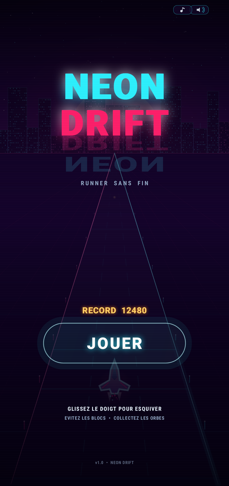
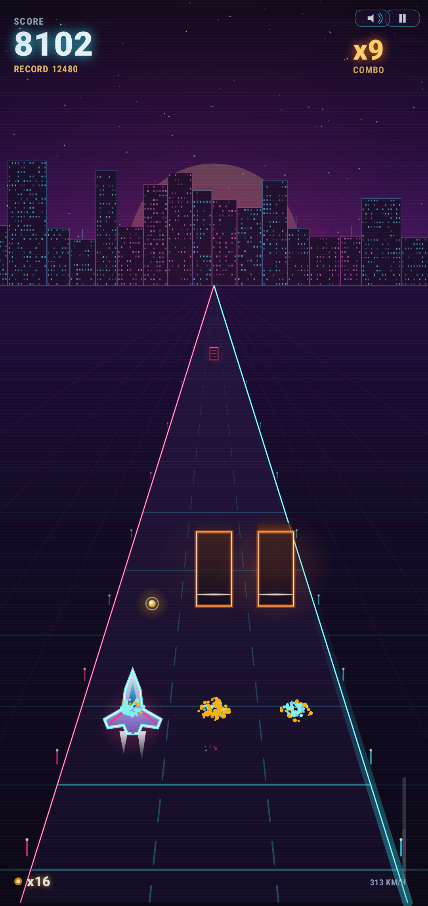
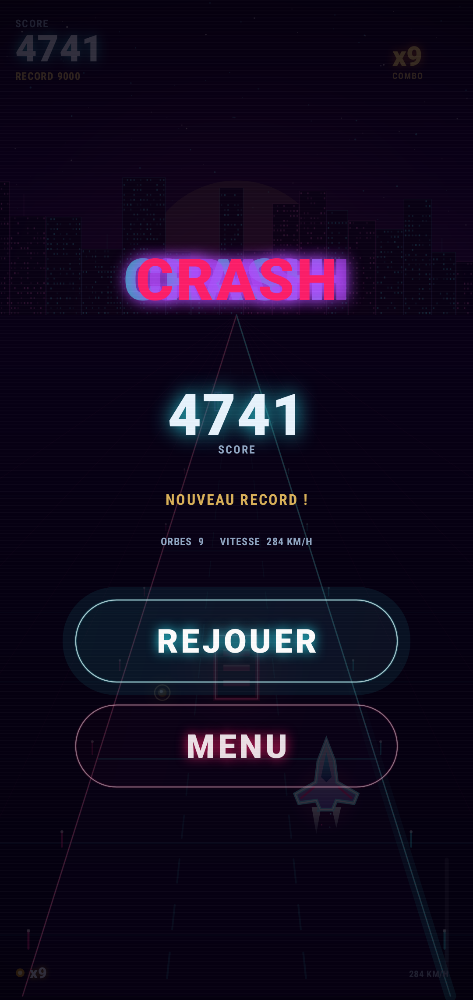

<div align="center">

# NEON DRIFT

**Un runner arcade néon pour Android — sans dépendance, sans moteur, 724 Ko.**

[-brightgreen)](https://developer.android.com)
[](dist/NeonDrift-1.0.apk)
[](#tests)

</div>

---

## Le jeu

Vous pilotez un chasseur néon sur une autoroute synthwave infinie. Trois voies,
des barrières d'énergie, des orbes à collecter, et une vitesse qui monte jusqu'à
rendre l'écran fou.

| Menu | En jeu | Game over |
|---|---|---|
|  |  |  |

*(ces trois images sont de **vraies captures du code du jeu**, rendues hors
téléphone par le harnais Robolectric décrit plus bas — pas des maquettes)*

### Règles

| Élément | Effet |
|---|---|
| **Route qui défile** | +1 point par fraction de distance (le score monte plus vite à haute vitesse) |
| **Orbes dorés** | +25 points × multiplicateur de combo |
| **Frôler un obstacle** | +12 points × multiplicateur, et le combo monte d'un cran |
| **Toucher un obstacle** | fin de la partie immédiate |

Le multiplicateur de combo monte jusqu'à **×9** et retombe après 2,6 s sans
exploit. Le record est sauvegardé localement (`SharedPreferences`).

### Commandes

* **Glisser le doigt** n'importe où sur l'écran : le vaisseau suit le doigt
  (avec une petite inertie, pas de téléportation).
* **Bouton pause** (en haut à droite) ou bouton retour Android : met en pause
  (le jeu se met aussi en pause automatiquement si vous quittez l'app).
* **Haut-parleur / note de musique** : coupe les effets / la musique.

## Contenu du dépôt

```
app/src/main/java/com/neondrift/rush/
├── core/                 # simulation pure Java, sans aucun import Android
│   ├── Engine.java       # boucle de jeu, apparition des obstacles, collisions
│   ├── Entity.java       # obstacle / orbe (données pures)
│   ├── Events.java       # événements de jeu (son, particules)
│   └── Perspective.java  # projection pseudo-3D de la piste
├── NeonRenderer.java     # tout le dessin (Canvas + Paint, zéro librairie)
├── GameView.java         # SurfaceView, boucle de rendu, entrées, états d'écran
├── MainActivity.java     # activité unique, plein écran immersif
├── Sfx.java              # SoundPool + MediaPlayer
├── Prefs.java            # record, compteurs, réglages
└── Palette.java          # palette synthwave

app/src/main/res/         # icônes (adaptatives + PNG), thème, sons générés
test/EngineTest.java      # 40 tests de la simulation (JVM pure, sans Android)
test/render/              # harnais de capture d'écran hors appareil (Robolectric)
tools/gen_audio.py         # génère tous les .wav (effets + boucle musicale)
tools/gen_icons.py         # génère les icônes PNG
build.sh                  # compilation + signature de l'APK sans Gradle
dist/NeonDrift-1.0.apk    # l'APK signé, prêt à installer
```

## Intégration continue

Chaque push, chaque pull request et chaque tag `v*` déclenche
[`.github/workflows/build.yml`](.github/workflows/build.yml) sur GitHub Actions :

| Job | Ce qu'il fait |
|---|---|
| `APK signé + tests JVM` | installe les paquets du SDK, lance `./build.sh --test`, vérifie l'APK (`aapt2`, `apksigner`), publie l'APK en artefact et l'attache à la release si c'est un tag |
| `Tests de rendu et de non-régression` | résout Robolectric, dessine les écrans hors appareil, rejoue le test de régression du redimensionnement et archive les captures |

Rien n'a besoin d'être compilé sur une machine locale : les binaires sortent de
la CI (`Actions` → dernier run → `Artifacts` → `NeonDrift-apk`).

## Tests

### 1. La simulation — `test/EngineTest.java`

27 assertions exécutables sans Android (JDK seul, démarrage instantané) :

```bash
./build.sh --test
```

Elles couvrent, entre autres :

* **déterminisme** : deux parties avec la même graine donnent exactement le même
  résultat, deux graines différentes divergent ;
* **collisions** : un obstacle pile sur la trajectoire tue, une orbe alignée est
  collectée, un frôlement déclenche le combo sans tuer ;
* **équité du générateur** : un autopilote qui se contente de viser la voie libre
  survit **3 minutes sur 6 graines différentes** — le jeu ne produit jamais de
  configuration impossible ;
* **indépendance du framerate** : 30 s simulées à 60 fps et à 144 fps donnent la
  même distance à 0,1 % près ;
* **pas de tunneling** : même avec un pas de temps de 50 ms (chute de framerate),
  aucun obstacle n'est traversé ;
* **mémoire** : le nombre d'entités vivantes reste borné (pool d'objets, aucune
  allocation par frame) ;
* **courbe de difficulté**, **événement de nouveau record**, **gel de la
  simulation après la mort**.

### 2. Le rendu et la non-régression — `test/render/`

* `ResizeRegressionTest.java` — reproduit le plantage corrigé en 1.1 : un
  `resize()` ne doit jamais recycler un bitmap qu'une frame est en train de
  dessiner, et une nouvelle taille doit être appliquée à la frame suivante.
  Ce test échoue sur la 1.0 et passe sur la 1.1.
* `RenderHarness.java` — produit les captures ci-dessus et vérifie le rendu.

Le renderer réel est exécuté hors du téléphone (Robolectric en mode graphique
natif), ce qui produit les captures du dossier `screenshots/` **et** vérifie
qu'aucune taille d'écran ni aucun état ne provoque d'exception : 7 résolutions de
320×480 à 1440×3200, les 4 modes d'écran, un monde vide et un monde surchargé de
200 entités.

```bash
cd test/render && mvn -q dependency:build-classpath -Dmdep.outputFile=cp.txt
# voir test/render/README.md pour la commande complète
```

## Construire l'APK

Aucun Gradle, aucun Android Studio : `build.sh` enchaîne directement
`aapt2 → javac → d8 → zipalign → apksigner` en une dizaine de secondes.

```bash
export ANDROID_SDK_ROOT=/chemin/vers/Android/Sdk   # build-tools 34 + platform 34
./build.sh            # -> dist/NeonDrift-1.0.apk
./build.sh --test     # idem, après les 40 tests
```

Détails, prérequis et procédure d'installation sur le téléphone : **[BUILD.md](BUILD.md)**.

## Choix techniques

* **Zéro dépendance** : uniquement le framework Android. Pas d'AndroidX, pas de
  moteur, pas de librairie graphique. L'APK fait 724 Ko, dont 600 Ko d'audio.
* **Simulation séparée du rendu** : `core/` n'importe rien d'Android, ce qui rend
  la logique testable sur une simple JVM. C'est ce qui permet les tests d'équité
  et de déterminisme ci-dessus.
* **Projection pseudo-3D maison** : la piste est projetée avec une courbe de
  profondeur en puissance plutôt qu'un `1/d` classique. Le `1/d` est fidèle
  optiquement mais écrase le champ proche si violemment qu'un obstacle ne devient
  lisible qu'une fraction de seconde avant l'impact. La courbe utilisée garde
  l'illusion de perspective tout en donnant à chaque tranche de profondeur une
  part équitable de l'écran.
* **Canvas matériel** : le rendu passe par `SurfaceHolder.lockHardwareCanvas()`
  (API 23+) avec repli automatique sur `lockCanvas()`. Les couches statiques
  (ciel, soleil, skyline, scanlines) sont pré-rendues une fois par taille
  d'écran dans des bitmaps.
* **Aucune allocation par frame** : particules en tableaux de primitives,
  entités recyclées via un pool, tri par insertion sur un tableau réutilisé.
* **Audio synthétisé** : tous les sons sont générés par `tools/gen_audio.py`
  (synthèse additive, aucun échantillon externe), donc aucun problème de licence.

## Compatibilité

* Android 5.0 (API 21) et supérieur, testé jusqu'à l'API 34.
* Orientation portrait, plein écran immersif, écran maintenu allumé.
* Aucune permission demandée à part `VIBRATE` (retour haptique).

## Licence

MIT — voir [LICENSE](LICENSE).
